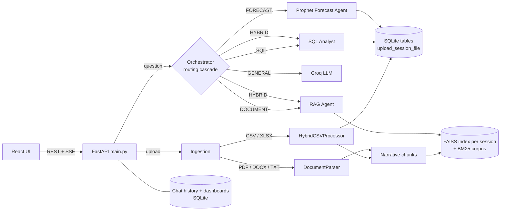

# InsightAI

**Ask business questions about your own spreadsheets and documents in plain language, and get answers backed by exact SQL, cited document passages, charts and forecasts.**

InsightAI is a full-stack AI analytics assistant. Upload CSV/Excel files and PDF/DOCX/TXT documents into a session, then ask questions in English or another language. An orchestrator decides whether each question needs a SQL calculation, a document search (RAG), both, a time-series forecast, or just a conversational reply, and sends it to the right agent.


---

## Why this exists

Business questions usually span two kinds of data:

- **Structured data** (sales exports, HR sheets), where answers must be *exact*. An LLM reading raw CSV text will guess at totals and averages.
- **Unstructured documents** (plans, reviews, reports), where answers need *retrieval and citations*, and the model must refuse when the document doesn't say.

A plain chatbot handles neither reliably. InsightAI routes each question to the method that can answer it correctly: generated SQL for numbers, hybrid retrieval with reranking for documents, and Prophet for forecasts. It refuses instead of inventing an answer when nothing relevant is found.

## Key features

| Feature | How it works |
|---|---|
| **Natural language → SQL** | The LLM writes SQLite for the session's uploaded tables. The real column values are injected into the prompt so `WHERE` clauses match the data exactly. If the query fails, the database error is sent back to the LLM for **one self-correction retry**. |
| **Read-only SQL guard** | All LLM SQL runs through a statement allow-list (single `SELECT`/`WITH`, no `INSERT`/`DROP`/`ATTACH`/...) **and** a read-only SQLite connection. |
| **Hybrid RAG** | BM25 (keyword) + FAISS (semantic) ensemble → cross-encoder reranking → top-3 chunks → grounded answer with source file names. |
| **Hallucination guard** | If the reranker scores for the best chunks are below a threshold, the answer is *"This information is not available in the uploaded documents."* instead of a guess. A query-expansion retry runs first for low-scoring questions. |
| **CSV → SQL + RAG** | Each CSV becomes both a SQL table *and* narrative text chunks (one per row, one per category group, one dataset overview), so it can answer exact *and* descriptive questions. |
| **Routing** | Rule cascade (greetings, forecast keywords, chart requests, vocabulary overlap with each source, causal keywords) with an LLM classifier as the last fallback. |
| **Hybrid answers** | SQL and RAG agents run concurrently; the LLM merges the numbers and the context into one answer. |
| **Forecasting** | Prophet with 95% intervals, automatic date/value column detection, anomaly flags for points outside the interval, and an LLM-written business summary. |
| **Charts** | Bar / line / pie specs generated from SQL results and rendered with Chart.js. Charts can be pinned to per-session dashboards. |
| **Multilingual** | Language detection (script-based for CJK/Arabic/Hindi, `langdetect` otherwise); answers come back in the question's language. |
| **Reliable LLM calls** | One client factory (`utils/llm.py`) gives every agent the same timeout and retry-with-backoff policy, so a Groq 429 or a transient 5xx is retried instead of failing the question. |
| **Streaming chat** | Server-Sent Events: routing tag and chart arrive first, then the answer text. |
| **Integrations** | Minimal MCP-style tool endpoints (`/mcp/*`) and an agent-to-agent message registry (`/a2a/registry`). |
| **Evaluated** | An offline pytest suite (CI) plus a live evaluation harness that scores routing, SQL exactness, RAG faithfulness, refusals and language detection. |

## Tech stack

| Layer | Technology |
|---|---|
| Backend API | Python 3.12, FastAPI, Uvicorn, slowapi (rate limits, API keys) |
| LLM | Groq API (`openai/gpt-oss-120b` by default) via LangChain |
| Retrieval | FAISS, rank_bm25, `sentence-transformers/all-MiniLM-L6-v2` embeddings, `cross-encoder/ms-marco-MiniLM-L-6-v2` reranker |
| Data | pandas, SQLite, openpyxl, pypdf, python-docx |
| Forecasting | Prophet |
| Frontend | React 19, Vite, Tailwind CSS 4, Chart.js, marked |
| Testing / CI | pytest, GitHub Actions, custom LLM evaluation harness |

## Architecture



Agents never call each other directly: the orchestrator wraps each one as an A2A peer and sends messages through `protocols/a2a.py`'s registry.

### Query flow

1. **Classify** (`agents/orchestrator.py`), cheapest rules first:
   1. Greeting / general knowledge → `GENERAL`
   2. Forecast keywords + a CSV in the session (and not a historical question) → `FORECAST`
   3. No uploads → `GENERAL`; documents only → `DOCUMENT`
   4. Chart request on CSV data → `SQL`
   5. CSV and documents both present: score question words against each source's unique vocabulary, using reranker dominance as a tie-breaker → `SQL` / `DOCUMENT` / `HYBRID`
   6. Causal or comparison wording ("why", "compare") → `HYBRID`
   7. Fast regex router, then an LLM classifier at temperature 0 as the last resort
2. **Execute** the chosen agent(s).
   - **SQL agent:** schema with sample values → SQL → sanitise → read-only guard → execute → one self-correction retry on error → explanation. A single number skips the explanation LLM.
   - **RAG agent:** BM25 + FAISS (k=10) → dedupe → cross-encoder rerank (top 3) → threshold check → answer from those 3 chunks with citations.
   - **Forecast agent:** load the session's table → detect date and value columns → infer frequency → Prophet fit → anomalies → narrative.
3. **Respond:** `/query/stream` sends a `meta` event (routing, chart, data, SQL, sources), then `token` events, then `done`. The reply and its chart are saved to chat history.

## Project structure

```
InsightAI/
├── main.py                  FastAPI app: all HTTP routes, upload handling, serves the built UI
├── config.py                Settings from environment / .env
├── auth.py                  API-key dependency + rate limiter
├── agents/
│   ├── orchestrator.py      Routing cascade + A2A dispatch + hybrid synthesis
│   ├── sql_analyst.py       NL → SQL, self-correction retry, explanation, chart spec
│   ├── session_rag.py       Per-session BM25 + FAISS + cross-encoder RAG with refusal guard
│   └── forecast_agent.py    Prophet forecasting + anomaly detection
├── parsers/
│   ├── hybrid_csv_processor.py   CSV/XLSX → SQL table + narrative RAG chunks
│   └── document_parser.py        PDF / DOCX / TXT → LangChain documents
├── database/
│   ├── db_manager.py        SQLite access, read-only query guard
│   └── sample_data.py       Sample business DB used by the evaluation suite
├── tools/                   SQL executor, value normaliser, CSV router, language detector
├── protocols/a2a.py         Agent-to-agent message registry
├── mcp/mcp_server.py        MCP-style tool server behind /mcp/*
├── chat/chat_history.py     Conversations, messages, dashboards (SQLite + Redis/fakeredis cache)
├── utils/                   LLM client factory, logger, plot-spec builder, upload validation
├── frontend/                React app (Chat, Dashboard and Forecast tabs)
├── tests/                   Offline pytest suite (no network, no model downloads)
├── evaluation/              Live LLM evaluation harness + latest report
├── scripts/benchmark.py     HTTP benchmark against a running server
├── sample_data/             Example CSV / XLSX / DOCX / TXT files to try
├── Dockerfile               Single container: API + built UI (used for Hugging Face Spaces)
└── .github/workflows/ci.yml Tests + frontend build on every push
```

## Getting started

### Prerequisites

- Python **3.11 or 3.12** (the pinned `numpy`/LangChain versions do not support 3.13 yet)
- Node.js 20+
- A free Groq API key: <https://console.groq.com/keys>

The first start downloads two small Hugging Face models (about 200 MB total).

### 1. Backend

```bash
git clone https://github.com/amanjaiswal-07/InsightAI.git
cd InsightAI
python -m venv .venv
```

Activate it (`.venv\Scripts\activate` on Windows, `source .venv/bin/activate` on macOS/Linux), then:

```bash
pip install -r requirements.txt
```

```bash
cp .env.example .env
```

Edit `.env` and set `GROQ_API_KEY`. Then start the API on <http://localhost:8000> (interactive docs at `/docs`):

```bash
python main.py
```

### 2. Frontend (development)

```bash
cd frontend
npm install
npm run dev
```

Open <http://localhost:3000>. The Vite dev server proxies API calls to port 8000.

### Single-server mode

Build the UI once and FastAPI serves it at <http://localhost:8000>:

```bash
cd frontend && npm run build
```

### Docker

```bash
docker build -t insightai .
docker run -p 7860:7860 -e GROQ_API_KEY=your_key insightai
```

## Deployment (Hugging Face Spaces)

The repo includes a `Dockerfile` that builds the React UI and serves it from FastAPI on port 7860. That is the layout Hugging Face Docker Spaces expect, and the free CPU tier has enough RAM for torch and the two models.

1. Create a Space at <https://huggingface.co/new-space> and choose **Docker** (blank template, free CPU).
2. In the Space's **Settings → Variables and secrets**, add the secret `GROQ_API_KEY`. Optionally add `API_KEYS` as well.
3. Push this repository to the Space's git remote:

   ```bash
   git remote add space https://huggingface.co/spaces/<your-user>/<space-name>
   ```

   ```bash
   git push space main
   ```

4. The Space builds the image (about 10 minutes) and serves the app at `https://<your-user>-<space-name>.hf.space`.

The Space's README needs Hugging Face front matter (`sdk: docker`, `app_port: 7860`); add it in the Space if the build asks for it.

Notes:

- Every visitor uses **your** Groq quota.
- Free Spaces sleep after a period of inactivity.
- Uploaded files and sessions are wiped whenever the Space restarts.

## Using it

1. Click **New session** and upload files, for example everything in `sample_data/`.
2. Wait for the "processing" indicator to finish (CSV import, chunking and embeddings).
3. Ask questions. Some examples with the sample files:
   - `What is the total revenue by region?` → **SQL**
   - `Show a bar chart of units sold by product` → **SQL** + chart
   - `What budget was approved for AI integration?` → **DOCUMENT** with source
   - `Why did profit change and what do the numbers show?` → **HYBRID**
   - `What is the CEO's phone number?` → refused (not in the documents)
4. **Forecast tab:** choose a numeric column and horizon, then run a Prophet forecast (`sample_data/forecast.csv` works well).
5. **Dashboard tab:** pin charts from the chat into named dashboards.

## Configuration

All settings live in `.env` (see [`.env.example`](.env.example)). Only `GROQ_API_KEY` is required.

| Variable | Default | Purpose |
|---|---|---|
| `GROQ_API_KEY` | none | **Required.** Groq API key |
| `LLM_MODEL` | `openai/gpt-oss-120b` | Any Groq chat model |
| `API_KEYS` | empty | Comma-separated keys for the `X-Api-Key` header. Empty disables auth (local dev). |
| `CORS_ORIGINS` | `*` | Allowed browser origins |
| `MAX_UPLOAD_MB` | `25` | Per-file upload limit |
| `DB_PATH` / `CHAT_DB_PATH` / `VECTOR_STORE_PATH` | `./data/...` | Where SQLite DBs and FAISS indexes are stored |
| `EMBEDDING_MODEL` / `RERANKER_MODEL` | MiniLM models | Hugging Face model ids |
| `REDIS_HOST` / `REDIS_PORT` | `localhost:6379` | Optional chat-history cache. Falls back to in-process fakeredis. |
| `LLM_TIMEOUT` / `LLM_MAX_RETRIES` | `60` / `5` | Per-request timeout and retries (429 / 5xx / timeout) |
| `LOG_LEVEL` / `LOG_FILE` | `INFO` / `./logs/app.log` | Logging |

Frontend variables (`frontend/.env`): `VITE_API_BASE_URL` (empty means same origin) and `VITE_API_KEY` (only if `API_KEYS` is set; it ends up in the browser bundle, so it is not a secret).

## API

Interactive OpenAPI docs: `http://localhost:8000/docs`.

| Method | Path | Description |
|---|---|---|
| `POST` | `/conversations` | Create a session `{user_id, title}` |
| `GET` | `/conversations` | List sessions for `X-User-ID` |
| `GET` / `DELETE` | `/conversations/{id}` | Get messages / delete session, vectors, tables and uploads |
| `POST` | `/upload` | Multipart `files`, header `X-Conversation-ID`. Indexing runs in the background. |
| `GET` | `/conversations/{id}/processing-status` | `processing` / `ready` / `error` |
| `GET` | `/conversations/{id}/schema` | Uploaded columns classified as date / numeric / categorical / id |
| `POST` | `/query` | JSON answer, saved to history |
| `POST` | `/query/stream` | SSE answer (`meta`, `token`, `done`, `error` events) |
| `POST` | `/query/silent` | JSON answer, not saved (dashboard / forecast tabs) |
| `GET` / `POST` | `/conversations/{id}/dashboard` | Load / save dashboard state |
| `GET` | `/health`, `/status`, `/api/metrics` | Health and agent status |
| `GET` | `/mcp/tools/list` · `POST /mcp/tools/call` | MCP-style tools: `smart_query`, `forecast_query`, `get_status` |
| `GET` | `/a2a/registry` | Registered agents and their capabilities |

Example (after uploading a CSV to session `$CID`):

```bash
curl -X POST http://localhost:8000/query -H "Content-Type: application/json" -d "{\"question\": \"What is the total revenue by region?\", \"conversation_id\": \"$CID\"}"
```

The response includes `routing`, `sql_query`, `data` (rows), `explanation`, and a `plot` spec when a chart was requested.

## Data model

- **Uploaded tables** (`DB_PATH`): one table per uploaded CSV/XLSX, named `upload_<first 8 chars of session id>_<file name>`. Tables are scoped to their session. They survive restarts and are dropped when the session is deleted, or at startup if the session no longer exists.
- **Chat history** (`CHAT_DB_PATH`): `conversations(conversation_id, user_id, title, ...)`, `messages(message_id, conversation_id, role, content, routing, metadata JSON, is_visible, ...)`, `dashboards(conversation_id, state JSON, ...)`. Charts are stored in message metadata so they re-render when a session is reopened.
- **Vectors** (`VECTOR_STORE_PATH/<session id>/`): FAISS index plus docstore. On reload the chunks, file list and CSV tables are rebuilt from it.

## Testing and evaluation

### Offline tests (no API key, no network)

```bash
pip install -r requirements-dev.txt
pytest
```

The tests cover:

- the read-only SQL guard and SQL sanitising;
- the SQL agent end to end on real SQLite tables with fake LLM chains (including the self-correction retry and the single-value vs grouped-result handling);
- the routing cascade and the A2A forecast path;
- CSV ingestion and session isolation;
- forecast column and frequency detection;
- upload filename and session-id validation;
- DOCX chunking (headings kept with their content);
- SQL literal normalisation (identifiers never rewritten);
- the LLM client factory settings;
- RAG session restore after a restart.

CI runs these tests plus the frontend lint and build on every push.

### Live LLM evaluation

`evaluation/eval_suite.py` runs the real agents with real Groq calls, in-process. It needs `GROQ_API_KEY`.

```bash
python evaluation/eval_suite.py
python evaluation/eval_suite.py --skip-rag
```

The second command skips document ingestion and runs faster.

| Suite | What it checks |
|---|---|
| Routing accuracy | 15 labeled questions across SQL / DOCUMENT / HYBRID / FORECAST / GENERAL, each in a correctly-scoped session |
| SQL correctness | Executed answer vs ground truth computed independently in Python from `database/sample_data.py` |
| RAG faithfulness | Answers about the two sample `.docx` files must contain facts taken from those files |
| RAG refusal | Out-of-scope questions (phone numbers, live stock prices, ...) must be refused |
| Language detection | 9 languages |

**Latest run (2026-10-20, `openai/gpt-oss-120b` on Groq): 40/42 (95.2%)**

| Suite | Result | Avg latency |
|---|---|---|
| Routing accuracy | 13/15 (86.7%) | 2.9 s |
| SQL correctness | 8/8 (100%) | 8.5 s |
| RAG faithfulness | 5/5 (100%) | 1.3 s |
| RAG refusal | 5/5 (100%) | 3.5 s |
| Language detection | 9/9 (100%) | under 0.01 s |

The two misses are both expected-`HYBRID` questions. "Explain the sales trend and show the underlying numbers" went to `SQL`, and "Why did engineering perform well, and what were the department's total sales?" went to `DOCUMENT`. They are reported as-is rather than tuned away; the full per-case detail is in [`evaluation/eval_report.txt`](evaluation/eval_report.txt).

These are small hand-labeled sets (42 cases), so treat them as regression checks rather than a benchmark. Of four full runs during this cleanup, the other three scored 39/42 or 40/42. Every 39/42 run lost its extra case to a Groq 429 rate-limit error, which is what led to the retry policy in `utils/llm.py`.

Results are written to `evaluation/eval_report.txt` and `evaluation/eval_results.json`. LLM output varies a little between runs.

`scripts/benchmark.py` measures latency and routing over HTTP against a running server (`BENCHMARK_API_KEY` / `BENCHMARK_BASE_URL` env vars).

## Known limitations

- **SQLite only for uploads.** `DatabaseManager` can connect to Postgres/MySQL, but the CSV import, cleanup and schema code use SQLite syntax, and the drivers are not in `requirements.txt`.
- **Single process.** Upload-processing status and the session cache live in memory, so run one worker.
- **Groq rate limits.** On the free tier, `openai/gpt-oss-120b` allows 8,000 tokens per minute. The SQL-generation call alone sends about 1,700 tokens (schema, sample values and few-shot examples), so only a few questions per minute fit. Past that, the UI shows a "rate-limited, try again" message. A paid tier or a smaller `LLM_MODEL` raises the ceiling.
- **Routing is heuristic.** Ambiguous questions that mix calculation and explanation can land on `SQL` or `DOCUMENT` instead of `HYBRID`.
- **Streaming is simulated.** Agents produce the full answer first; `/query/stream` then streams it word by word.
- **`.xls` (legacy Excel)** is not accepted; save as `.xlsx` or `.csv`.
- **Uploads are not encrypted** and there are no user accounts: `X-User-ID` only separates session lists and is not authentication.

## Future improvements

These are *not* implemented yet:

- True token streaming from the LLM in each agent
- Postgres support for uploaded tables (dialect-aware import and cleanup)
- User authentication and per-user storage quotas
- Evaluation tracked over time in CI with a mocked or cached LLM
- Smaller frontend bundle (code-split Chart.js and marked)

## License

[MIT](LICENSE)
